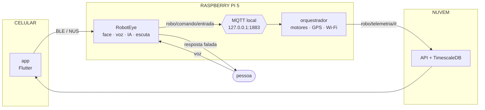

![[fontes/identidade/atlas-olhos-1024.png|180]]

# Atlas
### Conhecimento do projeto · Engenharia de Computação · SETREM

**Próxima entrega:** demonstração completa de um robô funcionando. [[wiki/planejamento/plano-do-projeto|Plano central]] · [[wiki/planejamento/site-e-acesso|Evolução do site e login]].

> [!abstract] O que é a Atlas, em três frases
> Um robô móvel que circula pelo campus e conversa com quem chega perto. Uma
> plataforma de aço com carenagem impressa em 3D, um Raspberry Pi 5 que ouve,
> pensa e fala, e um aplicativo que dirige e mostra por onde ele andou.
> São **três repositórios que rodam sozinhos** e precisam falar a mesma língua
> nas fronteiras — este vault é o mapa dessas fronteiras.

---

## Se você tem 15 minutos

Uma ordem de leitura que sai do zero e chega ao ponto de conseguir opinar:

| | Leia | Por quê |
|---|---|---|
| 1 | [[wiki/meta/glossario\|Glossário]] | Vinte termos que aparecem em tudo. Sem eles o resto trava. |
| 2 | [[wiki/arquitetura/visao-geral\|Arquitetura]] | Quem faz o quê, e onde cada programa roda. |
| 3 | [[wiki/estado/atual\|Estado atual]] | O que funciona hoje, conferido no robô. |
| 4 | [[wiki/historico/relatorios-semestre\|De onde viemos]] | O que o semestre anterior entregou e o que deixou aberto. |
| 5 | [[wiki/planejamento/prioridades\|Prioridades]] | O que está na fila, com IDs estáveis. |

Ou abra o **[[Mapa do projeto.canvas\|mapa visual]]** e navegue clicando.

---

## O sistema em uma imagem

> [!warning] O elo que ainda falta
> Os serviços do `orquestrador` **não estão instalados no Pi**. O comando sai do
> celular, atravessa o BLE, chega ao barramento — e morre ali, porque não há
> quem consuma. **O robô conversa, mas não anda.**
> Detalhe em [[wiki/estado/atual#O que está no ar hoje\|Estado atual]].

---

## Onde estamos hoje

> [!success] Funcionando e conferido no robô (10/09)
> Face, voz e conversa de pé · escuta reconhecendo **durante** a fala · voz
> `francisca` com o brilho ajustado à caixinha · 801 testes verdes.

> [!success] Atualização de 22/11
> LLM treinado **`atlas-qwen-r2`** (Qwen2.5-1.5B + LoRA) no Pi, só local: **64/72** na
> prova, contra 42/72 do modelo base; treino encerrado por platô (r3 64, r4 62) ·
> contas, xingamento e laço resolvidos no código · bateria de conversas **48/56** ·
> escuta **`vosk-pt-atlas`** (79% de frases certas) · face com expressões ligadas à
> fala · Pi enxuto (disco 43%). Ver [[wiki/estado/atual|Estado atual]].

> [!danger] Aberto, em ordem de impacto
> 1. **Serviços do orquestrador não instalados** — é o que impede o robô de andar.
> 2. **O modelo errava fatos** — mitigado em 22/11 pelo modelo treinado (64/72); os erros restantes estão na prova. Ver [[wiki/estado/divergencias]].
> 3. **Palavra de despertar** — o Vosk pequeno ouvia "classe" no lugar de "Atlas"; o `vosk-pt-atlas` (22/11) foi refeito para entender a Atlas. Precisão com voz humana no campus ainda não ensaiada.
> 4. **16 achados da revisão técnica** (AT-01 a AT-16), nenhum corrigido.

---

## Os três repositórios

| Pasta | Apelido | Responsabilidade | Código |
|---|---|---|---|
| `RobotEye` | a **cara** | Face, voz, IA, escuta e ponte BLE | [atlas_ai_v2](https://github.com/setrem-robot/atlas_ai_v2) |
| `orquestrador` | o **corpo** | Roteamento, motores, GPS, Wi-Fi e nuvem | [orquestrador](https://github.com/setrem-robot/orquestrador) |
| `app` | o **controle** | Direção, rota e telemetria | [aplicativo](https://github.com/setrem-robot/aplicativo) |

Detalhe de cada um em [[wiki/modulos/index|Catálogo dos componentes]].

---

## Por assunto

| Quero… | Abrir |
|---|---|
| Entender uma sigla ou termo | [[wiki/meta/glossario\|Glossário]] |
| Trabalhar como agente de IA | [[CONTEXTO-IA\|Contexto e protocolo]] |
| Saber o que funciona hoje | [[wiki/estado/atual\|Estado atual]] · [[wiki/estado/divergencias\|Divergências]] |
| Escolher a próxima tarefa | [[wiki/planejamento/prioridades\|Prioridades]] |
| Ver como as peças conversam | [[wiki/arquitetura/mapa-comunicacao\|Mapa de comunicação]] · [[wiki/api/contrato-mqtt\|Contrato MQTT]] |
| Consultar a revisão técnica | [[wiki/revisoes/2026-09-09-revisao-tecnica\|16 achados]] |
| Ligar, operar ou diagnosticar | [[wiki/configuracao/setup-completo\|Operação]] · [[wiki/configuracao/diagnostico\|Diagnóstico]] |
| Saber o que já foi feito | [[wiki/historico/registro-de-trabalho\|Registro de trabalho]] |
| Planejar um ensaio | [[wiki/planejamento/validacao\|Protocolos de validação]] |
| Achar um documento | [[wiki/index\|Mapa da documentação]] |

---

## Como este vault funciona

> [!tip] Contexto → estado → prioridades → evidência → ação → registro
> Informação sem **data** ou sem **fonte** deve ser confirmada antes de orientar
> uma mudança. Toda nota diz quando foi escrita e de onde veio.

Uma distinção que atravessa o vault inteiro e evita a maior parte dos enganos:

| Rótulo | Significa |
|---|---|
| **validado no hardware** | Rodou no robô e foi medido |
| **reproduzido em software** | Passou em teste, sem tocar no hardware |
| **análise estática** | Lido no código, não executado |
| **documentado por outra fonte** | Alguém escreveu; não foi conferido aqui |
| **planejado** | Ainda não existe |

Manutenção e convenções em [[wiki/meta/como-usar|Como usar e manter]] · fontes e
limites em [[wiki/meta/fontes|Fontes]] · o que ainda não foi conferido em
[[wiki/meta/verificacao|Verificação pendente]].

Algo novo e sem lugar ainda? Deixe em [[inbox/LEIA-ME|inbox]].
