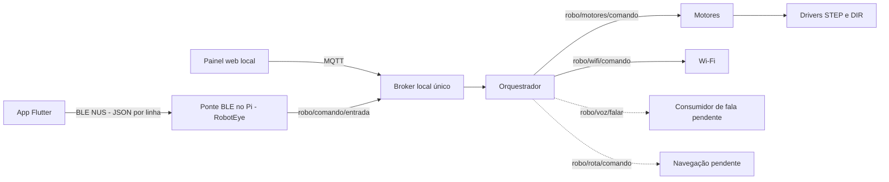
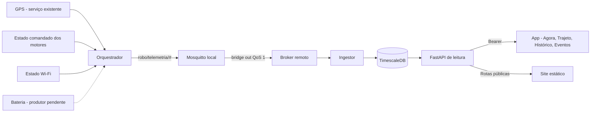
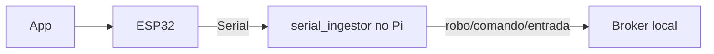
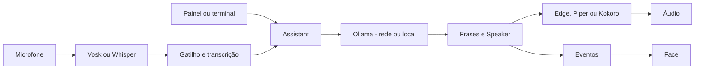

# Mapa de comunicação — atual e legado

## Controle atual implementado

Setas tracejadas terminam em consumidores que ainda faltam. A seta para drivers representa implementação encontrada, não teste físico realizado agora.

## Telemetria e banco

## Caminho legado preservado

O relatório anterior usava SPP nesse caminho. O firmware presente hoje usa BLE. Não misturar as duas versões. O destino MQTT é compartilhado, permitindo manter o restante dos serviços.

## Conversa e expressão

Os endereços e portas estão em [[wiki/configuracao/setup-completo]]. Os payloads ficam em [[wiki/api/contrato-mqtt]].

## Fontes e conferência

- [orquestrador/pi/services/orquestrador/src/orquestrador/main.py](https://github.com/setrem-robot/orquestrador/blob/98ee681498e05426ff47041ae7f8e7ec97d0ffaf/pi/services/orquestrador/src/orquestrador/main.py)
- [RobotEye/src/roboteye/ble/nus.py](https://github.com/setrem-robot/atlas_ai_v2/blob/43a6fe025ab5474cc1120d0a71d731392d1234b4/src/roboteye/ble/nus.py)
- [RobotEye/COMO-FUNCIONA.md](https://github.com/setrem-robot/atlas_ai_v2/blob/43a6fe025ab5474cc1120d0a71d731392d1234b4/COMO-FUNCIONA.md)

---
[[INICIO|Início]] · [[wiki/meta/fontes|Fontes e limites da documentação]]
