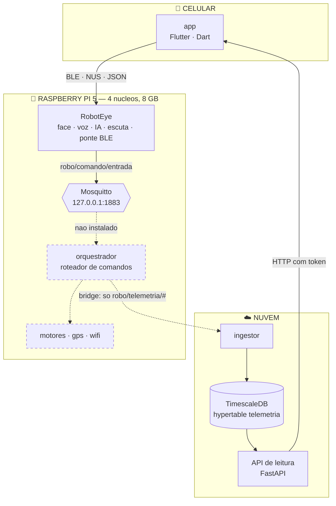

# Arquitetura — responsabilidades e fronteiras

A Atlas combina uma plataforma física, três repositórios de software e um repositório acadêmico. Os programas executam em ambientes diferentes: celular, Raspberry Pi e servidor/PC da nuvem. Uma máquina de IA na rede é opcional no desenho atual.

| Pasta local | Repositório | Responsabilidade | Executa onde |
|---|---|---|---|
| `app` | `setrem-robot/aplicativo` | Direção BLE, rota planejada e consulta de dados | Celular; alvos adicionais no projeto Flutter |
| `orquestrador` | `setrem-robot/orquestrador` | Roteamento, motores, GPS, Wi-Fi, legado ESP32 e nuvem | Pi e host Docker |
| `RobotEye` | `setrem-robot/atlas_ai_v2` | Face, voz, IA, escuta, BLE e painel local | Pi ou ambiente de desenvolvimento |
| Sem checkout de trabalho | `doc-interdisciplinar-4-semestre` | Relatório LaTeX | Compilação documental |
| Sem checkout de trabalho | `.github` | Apresentação da organização | GitHub |

## Onde cada coisa roda

As linhas tracejadas são o que **existe em código e não está instalado no Pi**.
É por isso que o robô conversa e não anda — ver [[wiki/estado/atual]].

## Fronteiras importantes

**Comandos:** entram no Pi pelo BLE do RobotEye e chegam ao tópico `robo/comando/entrada`. O orquestrador roteia; o serviço de destino executa. A API de nuvem é de leitura e não comanda motores.

**Informações:** serviços publicam status; o orquestrador seleciona o que espelhar; a bridge envia apenas `robo/telemetria/#`; o ingestor grava; a API lê; app e site apresentam.

**Conversa:** microfone/painel/terminal → Assistant → Ollama → Speaker → áudio e eventos visuais. O painel também possui MQTT para observar/enviar comandos, mas isso não constitui integração da IA com bateria/GPS ou consumo de `robo/voz/falar`.

**Retirada do ESP32:** o transporte direto no Pi já existe, preservando os UUIDs NUS e o formato JSON. O firmware e o `serial_ingestor` seguem presentes como alternativa histórica. Retirar o componente da montagem precisa ser comprovado por um ensaio sem ele.

**Autonomia:** o código de rota aceita e encaminha pontos; não foi encontrado serviço que execute navegação. Hoje a descrição tecnicamente sustentada é plataforma teleoperada com assistente conversacional e infraestrutura de telemetria.

Veja [[wiki/arquitetura/mapa-comunicacao]], [[wiki/modulos/index]] e [[wiki/decisoes/registro]].

## Fontes e conferência

- [orquestrador/README.md](https://github.com/setrem-robot/orquestrador/blob/98ee681498e05426ff47041ae7f8e7ec97d0ffaf/README.md)
- [app/COMO-FUNCIONA.md](https://github.com/setrem-robot/aplicativo/blob/44d500160ecf13d7d1db2a4fe0c54052d352c0aa/COMO-FUNCIONA.md)
- [RobotEye/src/roboteye/ble/mqtt.py](https://github.com/setrem-robot/atlas_ai_v2/blob/43a6fe025ab5474cc1120d0a71d731392d1234b4/src/roboteye/ble/mqtt.py)
- [RobotEye/src/roboteye/web/comandos.py](https://github.com/setrem-robot/atlas_ai_v2/blob/43a6fe025ab5474cc1120d0a71d731392d1234b4/src/roboteye/web/comandos.py)

---
[[INICIO|Início]] · [[wiki/meta/fontes|Fontes e limites da documentação]]
