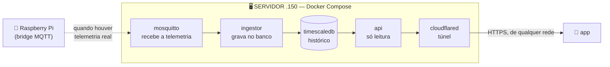

# Servidor .150 — a nuvem, centralizada

> [!warning] Migrado para o LARCC em 02/10/2026
> A pilha inteira (banco, API, site, túnel) agora roda na **VM do LARCC**, em
> `/root/docker-stacks/atlas` (acesso por Tailscale `100.118.95.115`). No `.150`
> ela ficou **parada**, só para rollback. O Pi manda a telemetria ao LARCC pela
> Tailscale. O resto desta nota descreve a pilha, que é a mesma; troque `.150`
> por LARCC e `~/docker-stacks` por `/root/docker-stacks`. Ver
> [[wiki/historico/registro-de-trabalho]] (02/10).

> [!abstract] O que este servidor faz
> Um único computador (`192.168.1.150`, Ubuntu) que roda **toda a parte de
> nuvem** da Atlas em Docker Compose: recebe a telemetria, guarda no banco, e
> serve ao aplicativo. Antes a API vivia no PC de alguém; agora está aqui, e
> "aqui" é um lugar só — é o que "centralizar" quer dizer.

> [!success] Status: no ar, em domínio fixo (10/09)
> A pilha inteira roda no `.150` em `~/docker-stacks/atlas`, com dados de
> demonstração, e a API responde **pela internet** em
> **`https://atlas.kerlonr.com.br/api`** — túnel Cloudflare nomeado, como serviço
> systemd (sobe sozinho no boot). Testado ponta a ponta: `/api/saude`,
> `/api/v1/estado` (com token) e `/api/v1/publico/resumo` (sem token).

> [!note] Para o app
> **URL:** `https://atlas.kerlonr.com.br/api` · **Token:** o `API_TOKEN` do
> `.env` em `~/docker-stacks/atlas/` no `.150` (não copiado para cá — ver
> [[wiki/meta/fontes|regra de segredos]]). Cole os dois nos ajustes do app.
> O código de busca do app já está correto; não precisou de mudança.

---

## As cinco peças, e o que cada uma faz

Todas sobem juntas com um comando, do mesmo `docker-compose.yml` que já estava no
repositório `orquestrador/cloud/`. Nada foi inventado para o `.150` — o compose
sempre foi escrito para rodar numa VM.



| Peça | Imagem | O que faz | Porta |
|---|---|---|---|
| **mosquitto** | `eclipse-mosquitto:2` | Recebe a telemetria da bridge do Pi | 1883 |
| **timescaledb** | `timescale/timescaledb:pg16` | Guarda o histórico em série temporal | 5432 (só loopback) |
| **ingestor** | build local | Assina `robo/telemetria/#` e grava no banco | — |
| **api** | build local (FastAPI) | Lê o histórico e serve ao app. **Só leitura.** | 8000 (só loopback) |
| **cloudflared** | `cloudflare/cloudflared` | Publica a API num domínio HTTPS, sem abrir porta | — |

> [!info] Por que o banco e a API só escutam no loopback
> Nem o Postgres nem a API ficam abertos à internet. O banco só é alcançável de
> dentro da VM; a API sai para o mundo **só pelo túnel**, que abre a conexão de
> dentro para fora. Não é preciso liberar porta nenhuma no firewall.

---

## Segurança que já vem desenhada

| Proteção | Como |
|---|---|
| A API não pode apagar dados | Usa um usuário de banco **só de SELECT** (`robo_leitura`), separado de quem grava |
| O histórico exige token | O app manda `Authorization: Bearer <token>`; sem ele, só as rotas públicas respondem |
| A localização exata não vaza | As rotas públicas arredondam o GPS para ~11 m (4 casas decimais) |
| O banco não fica exposto | Loopback + túnel; zero porta aberta no firewall |

---

## O que alimenta o banco

Hoje o Pi roda **só a face** — os serviços de GPS e motores do `orquestrador`
não estão instalados, então **telemetria real ainda não existe**. Ver
[[wiki/estado/atual]].

Por isso o começo é com **dados de demonstração** (`semear-demonstracao.py`): um
trajeto realista populado direto no banco, que prova o caminho
`banco → API → app` sem depender de instalar nada no Pi. Quando a telemetria
real existir, a bridge do Pi passa a publicar no mosquitto do `.150` e os dados
de exemplo saem de cena.

---

## Passo a passo do deploy

> [!note] Bloqueado em dois itens que só você tem
> **(1)** acesso SSH ao `.150` e **(2)** o `TUNNEL_TOKEN` da Cloudflare + o
> domínio. O resto está pronto: o `.env` de produção já foi gerado com senhas
> fortes, à espera desses dois.

1. **Copiar o repositório e o `.env`** para o `.150`.
2. **Gerar o `passwd` do Mosquitto** com a senha do `.env`:
   `docker run --rm eclipse-mosquitto:2 mosquitto_passwd -b -c /tmp/passwd piev <senha>` → salvar em `mosquitto/config/passwd`.
3. **Subir a base:** `docker compose up -d` (mosquitto, timescaledb, ingestor, api).
   Na primeira subida o banco cria o schema e o usuário de leitura sozinho.
4. **Semear a demonstração:** `python scripts/semear-demonstracao.py`.
5. **Conferir:** `curl http://127.0.0.1:8000/saude` deve responder OK.
6. **Ligar o túnel:** com o `TUNNEL_TOKEN` no `.env`, `docker compose --profile tunel up -d`.
7. **Apontar o app:** nos ajustes do app, `ATLAS_API_URL` = o domínio do túnel, e o `ATLAS_API_TOKEN` = o `API_TOKEN` do `.env`.

---

## Sobe com um comando só

Tudo — banco, ingestor, API, broker, Caddy e túnel — vive no **mesmo compose**.
Não há mais override de VM nem serviço systemd do host:

```bash
cd ~/docker-stacks/atlas
docker compose --profile tunel up -d
```

Sem o `--profile tunel`, os cinco primeiros sobem e o túnel não — é o modo de
rodar localmente. Todos com `restart=unless-stopped` (voltam sozinhos no boot).

## O túnel Cloudflare

Túnel **nomeado** `atlas-api` (`30bd9c0b-…`), da zona `kerlonr.com.br`, agora
como **serviço do compose** (`cloudflared-cloud`), por **config versionada** —
não por token de painel. A rota mora em `cloud/cloudflared/config.yml` no
repositório; as credenciais (`.json` + `cert.pem`) ficam ao lado, fora do git.

```
internet ─▶ atlas.kerlonr.com.br (Cloudflare, HTTPS)
         ─▶ cloudflared-cloud (túnel) ─▶ caddy:80
         ─▶ corta /api ─▶ api:8000
```

- **Config no repo:** `cloud/cloudflared/config.yml` (UUID + ingress → `caddy:80`).
- **Credenciais:** `cloud/cloudflared/*.json` e `cert.pem` (gitignore; `chmod 644` para o container ler).
- **DNS:** o `route dns --overwrite-dns` repontou `atlas.kerlonr.com.br` (que antes dava 1033) para este túnel.

> [!note] Túneis vizinhos, não tocados
> O `.150` já rodava outros túneis (`cloudflared-kerlonr.service`,
> `cloudflared.service`, além dos túneis `Atlas` vazio, `Bifrost` e `Crafty` na
> conta). Nenhum foi alterado. O túnel `Atlas` (sem conexões) ficou órfão do
> `atlas.kerlonr.com.br`; dá para apagá-lo no painel se quiser limpar.

## Site público e painel

O Caddy também serve a apresentação em `https://atlas.kerlonr.com.br/` e a tela de consulta em `https://atlas.kerlonr.com.br/painel/`. Os arquivos ficam em `~/docker-stacks/atlas/site/`, montados somente para leitura em `/srv/atlas`. As páginas e a API pública foram verificadas pela internet em 11/09/2026. Ver [[wiki/site-e-painel|Site e painel]] para manutenção, limites dos dados e validação.

## Como o app encontra a API

O app guarda a URL e o token nos ajustes (`atlas_api_url` / `atlas_api_token`),
e dá para embutir no build com `--dart-define=ATLAS_API_URL=...`. Trocar a API de
lugar é, do ponto de vista do app, mudar uma URL — nada mais.

---

## Estado dos itens

| Item | Estado |
|---|---|
| `.env` de produção com segredos | ✅ gerado, no `.150` em `~/docker-stacks/atlas/.env` |
| Serviços no ar (mosquitto, banco, ingestor, api) | ✅ rodando e saudáveis |
| Banco semeado | ✅ 7200 registros, 6 h de trajeto de demonstração |
| API acessível pela internet | ✅ `https://atlas.kerlonr.com.br/api`, túnel nomeado |
| Caddy cortando o `/api` | ✅ testado pela internet |
| Bug do `statement_timeout` na conninfo | ✅ corrigido ([orquestrador #14](https://github.com/setrem-robot/orquestrador/pull/14)) |
| Túnel como serviço (sobe no boot) | ✅ `cloudflared-atlas.service` |
| App apontado para o `.150` | ⏳ você cola URL + token nos ajustes do app |

> [!note] Onde ficou cada coisa no servidor
> - Pilha: `~/docker-stacks/atlas/` — sobe com `docker compose --profile tunel up -d` (um comando, sem override).
> - O `.env` (senhas, token da API) mora ali e **não** está no git.
> - A API não publica porta no host (a 8000 é do `crafty`); o Caddy fica na frente e a alcança pela rede interna.
> - O `API_TOKEN` que o app precisa está no `.env`. Não é copiado para cá.

> [!bug] Achado durante a implantação
> A API respondia 503 em toda rota: o `options` da conninfo tinha um espaço não
> citado, e o libpq recusava a conexão. É a mesma classe do bug do `keep_alive`
> no RobotEye — um teste que conferia o texto da string, não o parsing real.
> Corrigido e com teste que usa o parser do próprio psycopg. Ver
> [[wiki/historico/registro-de-trabalho]].

---
[[INICIO|Início]] · [[wiki/modulos/nuvem|Nuvem — da mensagem à informação]] · [[wiki/api/contratos|API HTTP]]
