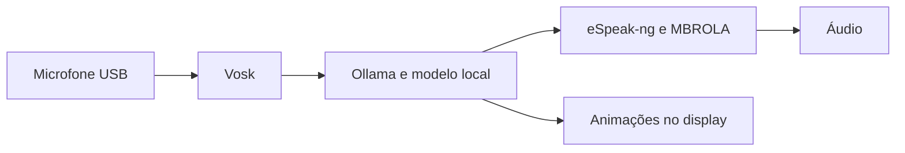

# Interface — da bancada à conversa local

## Ponto de partida

A equipe buscou uma interface que entendesse perguntas e respondesse em português sem depender de internet. O relatório descreve três etapas: percepção, cognição e expressão.

1. **Bancada no Pi 4 de 8 GB:** TinyLlama e Qwen2-0.5B via Ollama, entrada inicialmente por terminal, eSpeak-ng/MBROLA para a fala (p. 19–22).
2. **Migração para o Pi 5:** microfone USB, Vosk para reconhecimento e um modelo chamado “Gemma 3B” no documento (p. 22–24).
3. **Integração física:** display, caixas de som, organização dos cabos e início automático via systemd (p. 25).

## Ciclo documentado

Os autores relatam o ciclo completo funcionando na SETREM e uma avaliação informal positiva das expressões (p. 28). Não há amostra ou métricas suficientes nessa seção para quantificar taxa de acerto ou satisfação.

## Problemas e aprendizado

- Concorrência entre IA e áudio provocava travamentos; foram aplicados limites de resposta e ajustes de prioridade.
- Volume baixo apareceu na banca e motivou ajuste no mixer ALSA.
- A escolha de microfone USB veio da necessidade de uma entrada de áudio adequada.
- A base institucional era contextualizada no Modelfile.

Preservamos “Gemma 3B” como **nome usado pelo relatório**, não como identificação verificada de um artefato do Ollama. As referências a jack P2 e aos sistemas Bookworm/Trixie também pertencem ao relato histórico; o inventário de áudio e SO do robô atual precisa ser conferido fisicamente.

## Continuidade

Os trabalhos futuros das p. 30–31 são ampliar conhecimento da SETREM, testar com mais usuários, consolidar o áudio e evoluir as expressões. Hoje o código oferece motores de IA/voz intercambiáveis, reserva local, face por eventos, painel web e recuperação de áudio USB. Ver [[wiki/modulos/roboteye]] e [[wiki/planejamento/onde-queremos-ir]].

## Fontes e conferência

- [[fontes/relatorios/InterfacePDF.pdf#page=19|Desenvolvimento — p. 19]]
- [[fontes/relatorios/InterfacePDF.pdf#page=28|Resultados — p. 28]]
- [[fontes/relatorios/InterfacePDF.pdf#page=30|Conclusão e continuidade — p. 30]]

---
[[INICIO|Início]] · [[wiki/meta/fontes|Fontes e limites da documentação]]
