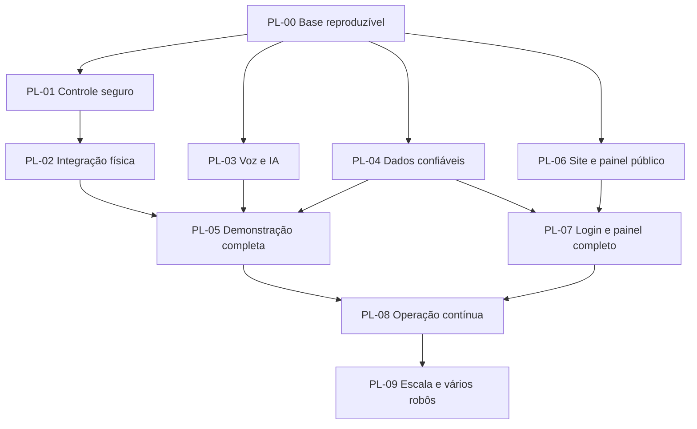

# Plano do projeto

[[INICIO|Início]] · [[wiki/planejamento/site-e-acesso|Site, painel e acesso]] · [[wiki/planejamento/prioridades|Achados técnicos]]

## Objetivo e limite

**Próxima entrega confirmada pelo usuário: demonstração completa de um robô funcionando.** O site deve explicar melhor o projeto e o painel deve oferecer informações gerais sem login e informações completas com acesso autorizado.

Este é o plano central de evolução, não um diário. `PL-*` identifica entregas; `AT-*` mantém exclusivamente os achados da revisão técnica. Os antigos códigos do backlog não correspondem aos achados e não devem ser usados para atribuir trabalho novo. Nenhuma implementação é concluída por aparecer neste plano.

## O que foi conferido

Inspeção local e consultas públicas em 11/09/2026, sem novos ensaios físicos ou execução das suítes completas.

| Base | Evidência | Implicação |
|---|---|---|
| Site, painel e saúde da API | HTTP 200 no domínio; títulos das duas páginas conferidos | A apresentação e a consulta pública estão publicadas |
| Cópia local do site | `site/painel/index.html` ausente; HTML local diferente do publicado | Reconciliar e versionar antes do próximo deploy; causa da divergência não determinada |
| Orquestrador | `main`, HEAD `69f2fce` | Inclui correção de conninfo e serviço de telemetria do Pi; instalação deste serviço não conferida |
| App | `main`, HEAD `44d5001`; `send()` ainda arma repetição depois de `await _write()` | AT-01 continua prioritário; padrão de código da reprodução histórica permanece |
| RobotEye | `producao`, HEAD local `9645372` | Diferente da revisão de 09/09; revalidar achados no código atual e no Pi |
| Banco/API | `options` delimitado em `banco.py`, com teste de parser versionado | AT-02 possui correção; falta conferir todos os critérios de aceite |
| Concorrência API | Rotas `async def` chamam `Banco.consultar()` síncrono | AT-03 continua aplicável por análise estática |
| Login | `seguranca.py` compara um único `API_TOKEN` | Existe acesso por token compartilhado; falta identidade, permissão e revogação por pessoa |
| Documentação | Prioridades e backlog atribuem significados diferentes a AT-01…14 | Usar este plano para entregas e a revisão para defeitos |

O restante da revisão é uma lista de riscos a revalidar, não uma nova afirmação sobre todas as versões atuais. Estado instalado, código local e versão publicada precisam de evidências separadas.

## O que significa demonstrar a Atlas

Roteiro proposto, repetível por alguém além de quem desenvolveu:

1. Ligar o robô e identificar versão, serviços e condição de alimentação.
2. Conectar um celular autorizado ao BLE do Pi; conferir o caminho efetivamente usado e a retirada do ESP32 prevista no projeto.
3. Executar movimento curto em área controlada e parar. Soltar o botão, perder BLE e fechar o app também precisam produzir parada.
4. Fazer perguntas de referência; ouvir respostas compreensíveis, com fatos conferidos e reação definida à falta de rede.
5. Obter GPS real em local apropriado e acompanhar o caminho sensor → MQTT → banco → API → painel. Sem fix deve aparecer como indisponível.
6. Mostrar a idade e a origem dos dados. CPU, temperatura e memória podem compor a demonstração depois de validar o novo produtor. Bateria só aparece como medição se houver sensor real.
7. Interromper e recuperar a rede: a interface indica dados antigos e a reconexão não reproduz movimento vencido.

**Aceite proposto:** três execuções consecutivas do roteiro, incluindo reinicialização, sem falha de parada; registrar tempos, falhas, versões e evidências em uma ficha de validação. Medir distância de parada e acordar limite adequado ao hardware antes do ensaio no chão. Login não bloqueia esta demonstração se o painel público já mostrar os dados necessários.

## Ordem das entregas

Os ramos independentes podem avançar na equipe conforme disponibilidade; não exigem aumentar o número de agentes. As prioridades abaixo indicam ordem de decisão, não datas prometidas.

| Entrega | O que atacar e entender | Dependência | Como comprovar |
|---|---|---|---|
| **PL-00 · Agora — base reproduzível** | Conferir SHAs instalados no Pi/servidor; recuperar fonte publicada do site sem sobrescrever mudanças; versionar deploy e seus scripts; definir broker único e instalação sem ESP32; responsável por integração e data da demonstração | Acesso aos ambientes e inventário | Outro integrante identifica versão e inicia cada parte com instruções únicas; comparação local/publicado registrada |
| **PL-01 · Agora — controle seguro** | Corrigir corrida de STOP; invalidar escritas pendentes; expirar comandos por sessão/sequência; impedir replay; autorizar controlador BLE; verificar parada independente e alimentação | PL-00; AT-01/04/08 | Testes de concorrência, botão rápido, troca de tela, desconexão e broker; ensaio em bancada antes do chão |
| **PL-02 · Próximo — integração física** | Instalar/configurar serviços no Pi; confirmar pinos, drivers, corrente, sentidos, rodas, fonte e fusíveis; integrar GPS físico; evitar conflito de broker | PL-01; AT-14 | Reiniciar e repetir comando/retorno; fix GPS real, perda de fix e retomada; limites de hardware documentados |
| **PL-03 · Próximo — voz e IA** | Medir reconhecimento em ambiente real; cancelamento e interrupção; evitar ouvir a própria fala; fonte curada de informações SETREM; respostas de incerteza; orçamento CPU/RAM/temperatura | PL-00; AT-10/13/16 revalidados | Conjunto fixo de perguntas e ruídos; acerto factual, falhas e tempos antes/depois; perda de rede e áudio USB; uso simultâneo com controle |
| **PL-04 · Próximo — dados confiáveis** | Origem real/demo, horário de geração/recepção, unidade, qualidade e validade; id de evento; validação do payload; fila limitada e persistência idempotente; corrigir concorrência API, paginação e limites de séries | PL-00; AT-02/03/05/11/12 | Sensor real até painel; eventos repetidos não duplicam; falha do banco/rede recupera conforme garantia definida; consulta lenta não bloqueia saúde |
| **PL-05 · Marco — demonstração** | Integrar PL-01/02/03/04; ensaiar roteiro, preparar apresentação e plano para falhas observáveis; responsável acompanha hardware | PL-01 a PL-04 | Roteiro aprovado acima e limitações explícitas; material acadêmico utiliza evidências reais |
| **PL-06 · Em paralelo — apresentação** | Narrativa, fotos/vídeo reais, arquitetura acessível, recursos com estado, equipe, resultados e próximos passos; visual e acessibilidade compartilhados com painel | PL-00; fontes de conteúdo | Visitante entende propósito, estágio e componentes; navegação por teclado e celular; API fora do ar não impede ler o projeto |
| **PL-07 · Depois da base — acesso completo** | Convidados, login, permissões na API, sessão/revogação; filtros e histórico; gráficos com unidades, origem e idade; auditoria mínima | PL-04 e PL-06; AT-09 | Público recebe só campos permitidos; usuário revogado perde acesso; chamadas diretas e cache não vazam dados; app continua funcionando |
| **PL-08 · Após demonstração — operação** | Backup externo restaurável, migrações, rollback código+dependências, métricas e alertas; CI entre repos; políticas de segredos, atualização e retenção | PL-05; AT-07/09/10/13/15/16 | Restauração em ambiente separado; instalação reproduzível; ensaio prolongado e falhas recuperáveis; responsável e procedimento definidos |
| **PL-09 · Quando houver demanda — escala** | `robot_id` ponta a ponta e autorização por robô; ACL MQTT; índices, retenção, limite de pontos e carga; custo de IA e recursos por robô | PL-08; AT-06/11/16 | Dois simuladores isolados e teste de carga com objetivos registrados; aumentar infraestrutura só após identificar gargalo |

## O que estudar para aplicar

| Assunto | Entendimento necessário | Exercício no projeto |
|---|---|---|
| Assincronismo e estado | Um `await` permite que outra operação mude a intenção; a mais antiga pode terminar depois | Reproduzir frente → STOP → conclusão atrasada e impedir novo timer (AT-01) |
| BLE e MQTT | Entrega não significa autorização nem validade; QoS não garante que movimento ainda faz sentido | Cortar conexão com comandos em trânsito; comparar sequência, sessão e validade |
| Telemetria | Estado comandado, estado medido e histórico são conceitos diferentes | Mostrar unidade, fonte, qualidade, geração e idade; nunca deduzir bateria de contagem |
| API e banco | Pool, concorrência, transações, índices e limites de resposta | Corrigir AT-03 e medir consultas lentas concorrentes; conferir timeout real de AT-02 |
| Identidade e acesso | Login identifica a pessoa; autorização decide quais dados ela pode consultar | Solicitar diretamente um robô não autorizado e receber negativa da API |
| Voz e IA | Qualidade depende de áudio, contexto e avaliação, além do modelo | Perguntas fixas e gravações com ruído; medir acerto, latência e interrupção |
| Operação | Backup útil precisa restaurar; rollback precisa recuperar ambiente e código | Restaurar banco separado e simular atualização malsucedida |

Para I/O bloqueante em rotas, consultar a [orientação oficial do FastAPI sobre concorrência](https://fastapi.tiangolo.com/async/). O desenho de acesso e suas fontes estão em [[wiki/planejamento/site-e-acesso]].

## Como avaliar escalabilidade

A arquitetura modular permite evolução, mas **capacidade não foi demonstrada**. Uma máquina pode ser suficiente para a primeira demonstração; isso não estabelece disponibilidade contínua nem suporte a uma frota.

Medir separadamente robô (tempo de parada, áudio, CPU, RAM e temperatura), ingestão (eventos/s, fila, atraso, perdas e duplicatas), API (clientes simultâneos, p95/p99 e erros) e banco (crescimento diário, índices, WAL e restauração).

Como experimento inicial, após corrigir concorrência e definir dados, testar 1/10/30 clientes simulados em ambiente isolado com histórico representativo. São pontos de medição propostos, não promessa de suporte. Cada aba que chama dois endpoints a cada 30 s gera em média 0,067 requisição/s; 30 abas geram cerca de 2/s, mas rajadas sincronizadas, login e gráficos mudam a carga.

Definir frequência de amostragem, dias de retenção, robôs e pessoas antes de dimensionar. Não adicionar réplicas idênticas do ingestor com o mesmo client ID; não introduzir Kubernetes, Redis ou processamento distribuído sem gargalo medido. Levar a identidade por robô ao contrato antes de conectar um segundo produtor físico.

## Primeiro pacote de trabalho

1. **PL-00:** reconciliar site publicado e repositório; conferir versão/serviços instalados e hardware disponível.
2. **PL-01:** corrigir AT-01 com teste que force conclusões fora de ordem; revisar validade de comandos antes de ensaio físico.
3. **PL-02/04:** ligar um produtor físico e rastrear um evento até o painel, distinguindo demonstração de medição.
4. **PL-03:** criar o conjunto de perguntas sobre a SETREM e medir a interação atual.
5. **PL-06:** preparar conteúdo e layout descritos na especificação; o login entra como entrega própria após definir acesso.

Cada pacote recebe responsável, tamanho estimado e data somente após confirmar disponibilidade. Preferir uma tarefa pequena com teste e critério de aceite a uma instrução genérica como “melhorar a IA”.

## Decisões que ainda precisam da equipe

- Data e duração da demonstração; espaço, público e rede disponíveis.
- Hardware pronto: motores, alimentação, GPS e eventual medição de bateria.
- Quem integra as frentes e acompanha ensaios físicos.
- Quem pode consultar dados completos; hipótese inicial: pessoas convidadas.
- Política para localização pública e dados de conversa; proposta: resumo público e trajeto demonstrativo, localização real detalhada restrita.

## Fontes e manutenção

Código inspecionado: `app/lib/services/robot_connection.dart`; `orquestrador/cloud/api/app/{main,banco,seguranca}.py`; `cloud/api/tests/test_banco.py`; histórico Git dos três repos. Referências: [[wiki/revisoes/2026-09-09-revisao-tecnica]], [[wiki/planejamento/onde-queremos-ir]], [[wiki/planejamento/validacao]], [[wiki/planejamento/equipe-e-entregas]] e [[wiki/site-e-painel]].

Atualizar a seção correspondente quando uma decisão mudar. O plano descreve destino, dependências e aceite; os contratos permanecem nos repositórios. Uma alteração aceita em software não encerra o ensaio físico correspondente.
